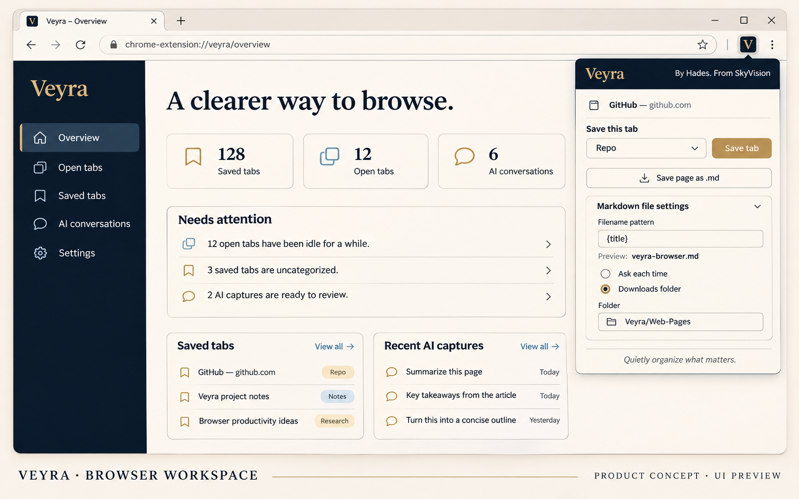

# ویرا (Veyra) — فضای کاری مرورگر

**ویرا (Veyra)** فضای کاری محلی و دوزبانهٔ مرورگر Chromium، ساختهٔ شرکت SkyVision و با طراحی Hades است. نام محصول ویرا است؛ SkyVision نام شرکت سازنده است.

*تصویر معرفی مفهومی بر پایهٔ رابط فعلی؛ داده‌ها نمونه‌اند و تصویر، اسکرین‌شات آزمون زندهٔ مرورگر نیست.*

**وضعیت:** کد افزونه و بستهٔ محلی نسخهٔ ۰.۱.۱۲ موجود است. تست‌های خودکار اجرا می‌شوند؛ آزمون کامل مرورگر زنده و انتشار در Chrome Web Store هنوز تأیید نشده است.

## نصب

1. فایل [`veyra-v0.1.12-chrome.zip`](dist/veyra-v0.1.12-chrome.zip) را از حالت فشرده خارج کنید، یا پوشهٔ ریپو را برای اجرای نسخهٔ توسعه انتخاب کنید.
2. در کروم به `chrome://extensions` بروید و **Developer mode** را روشن کنید.
3. **Load unpacked** را انتخاب و پوشه‌ای که `manifest.json` در آن است انتخاب کنید.
4. تب جدید باز کنید تا داشبورد ویرا را ببینید.
5. در بخش تنظیمات، ضبط گفتگوهای هر سرویس AI را **جداگانه** و با اجازه فعال کنید.

**نکته:** افزونه صفحه New Tab را جایگزین می‌کند، اما امکان تغییر مخفیانه تنظیمات راه‌اندازی کروم را ندارد. اگر می‌خواهید هنگام اجرای کروم هم باز شود، در تنظیمات Startup مرورگر، باز شدن صفحه تب جدید را انتخاب کنید.

## امکانات نسخه اولیه

- گروه‌بندی تب‌های باز بر اساس دامنه، شناسایی موارد تکراری، جستجوی نشانک‌ها.
- کارت‌های تصمیم **بله / نه** برای پیشنهادهای مرتب‌سازی. **هیچ تبی بدون تأیید بسته نمی‌شود.**
- آرشیو محلی و اختیاری چت‌های ChatGPT، Claude، Gemini، Perplexity و Grok. برداشت گفتگو از HTML صفحه انجام می‌شود و در صفحات طولانی یا با تغییر طراحی سرویس، ممکن است ناقص باشد.
- ذخیره متن یا لینک از منوی راست‌کلیک و خروجی Markdown مکالمات.
- خروجی و بازیابی JSON، نمایش اختیاری تاریخچه با اجازه، راست‌چین کردن فیلدهای ورود متن در سایت با اجازه اختصاصی.
- فارسی راست‌چین و انگلیسی چپ‌چین، تم تاریک/روشن و طراحی ساده.
- اتصال **اختیاری** به Laya محلی در `127.0.0.1:8000`. تصمیم مدل صرفاً پیشنهاد است و به‌تنهایی عملی انجام نمی‌دهد.
- popup بازطراحی‌شده با رنگ‌بندی SkyVision، دوزبانه و هماهنگ با حالت روشن/تیره؛ دارای انتخاب دستهٔ ذخیرهٔ تب و ذخیرهٔ صفحه به Markdown.
- الگوی نام فایل Markdown با `{title}`، `{domain}` و `{date}`؛ مقصد انتخابی در هر بار یا زیرپوشهٔ قابل تنظیم در Downloads. تنظیم برای popup و منوی راست‌کلیک مشترک است و مجوز Downloads هنگام نیاز درخواست می‌شود.
- اعلان پایان بعضی کارهای در حال اجرا در صفحات AI و اتصال اختیاری webhook برای ارسال رویداد پایان؛ پوشش به نشانه‌های قابل تشخیص رابط سایت وابسته است.
- بررسی نسخهٔ منتشرشدهٔ GitHub در شروع و به‌صورت دوره‌ای؛ این کار **فقط اطلاع از نسخه است** و کد افزونه را خودکار نصب یا به‌روزرسانی نمی‌کند.
- ذخیرهٔ تب از popup در دستهٔ کتابخانهٔ نشانک‌های Veyra؛ دسته‌های پیش‌فرض شامل Repo، Agents و AI LLM هستند و با دسته‌های سفارشی داشبورد تکمیل می‌شوند.
- نشانک‌های کروم در سکشن‌های جمع‌شونده بر اساس پوشهٔ فعلی نمایش داده می‌شوند؛ جست‌وجو در عنوان، پوشه و سایت و مرتب‌سازی بر اساس عنوان، تاریخ یا سایت دارد. این چیدمان، نشانک‌ها را جابه‌جا نمی‌کند.
- آرشیو گفتگوهای AI خودکار بر اساس سرویس و زمان (امروز، دیروز، این هفته، قدیمی‌تر) مرتب می‌شود؛ گروه‌بندی و ترتیب قابل تغییر است. جست‌وجو عنوان، نشانی، سرویس و متن پیام‌های ذخیره‌شده را می‌گردد و پیش‌نمایش کوتاهی از نتیجه می‌دهد.

جزئیات و محدودیت‌های خروجی Markdown، بررسی نسخه و webhook در [راهنمای قابلیت‌ها](docs/UPDATES_AND_PAGE_EXPORT.md) است.

## پایه‌های متن‌باز

از بخش‌های کوچک کد دو پروژه MIT یعنی [Tab Out](https://github.com/zarazhangrui/tab-out) و [LTF Builder](https://github.com/localthink-org/localthink-builder) با ذکر مجوز استفاده شده است. ویرا فورک رسمی هیچ‌کدام نیست. Laya پروژه مستقل [NandhaKishorM/laya](https://github.com/NandhaKishorM/laya) است و به‌صورت پیش‌فرض داخل افزونه نصب یا اجرا نمی‌شود.

## حریم خصوصی

ضبط گفتگو پیش‌فرض **خاموش** است و داده‌ها در دیتابیس محلی مرورگر می‌مانند. حساب کاربری، backend میزبانی‌شده یا تحلیل‌گر رفتاری وجود ندارد. فقط اگر خودتان فعال کنید، فرادادهٔ محدود به Laya محلی فرستاده می‌شود یا رویداد پایان کار به webhook دلخواه‌تان ارسال می‌شود؛ متن پرسش و پاسخ چت به webhook فرستاده نمی‌شود. داده‌های محلی رمزنگاری نشده‌اند؛ از پروفایل سیستم و فایل‌های خروجی حفاظت کنید.

## توسعه و ادامه پروژه

`npm test` تست‌ها را اجرا می‌کند؛ `npm run check` کد و تست‌ها را بررسی می‌کند. اطلاعات معماری، مسیر توسعه، قوانین ایجنت و هدف‌های غیرقابل‌تغییر در `docs/` و `AGENTS.md` آمده‌اند.

## نسخه 0.1.2 — رفع ذخیره خودکار چت و انتخاب مسیر

ابتدا در **Settings → Capture settings** روی «فعال‌سازی ذخیره خودکار چت‌ها» بزنید و دسترسی سایت‌های مدنظر را در پنجره Chrome تأیید کنید. همچنین می‌توانید هر سرویس را جداگانه فعال کنید. چت‌های باز پس از فعال‌سازی بررسی می‌شوند و گفتگوهای بعدی هنگام ایجاد و تغییر متن ثبت می‌شوند. اگر در چت خاصی ذخیره اتفاق نیفتاد، «بررسی چت‌های باز» را بزنید. فقط متن‌هایی که در صفحه بارگذاری و قابل مشاهده هستند قابل ثبت‌اند؛ در گفتگوهای قدیمی یا بسیار طولانی ممکن است بخشی بارگذاری نشده باشد.

محل ذخیره داخلی **IndexedDB مرورگر** است، اما برای ذخیره فایل‌های Markdown در کامپیوتر از **Settings → Chat storage location** سه گزینه دارید:

- **فقط داخل مرورگر:** آرشیو محلی و پشتیبان JSON.
- **زیرپوشه Downloads:** پوشه‌ای مثل `Veyra/AI-Chats` بنویسید؛ خروجی فایل‌ها با دسترسی Downloads و بدون نیاز به بازماندن داشبورد انجام می‌شود. مسیر مطلق خارج از Downloads به‌وسیله API مرورگر مجاز نیست.
- **پوشه دلخواه:** دکمه «انتخاب پوشه» مسیر دلخواه را با پنجره امن مرورگر انتخاب می‌کند. همگام‌سازی تا زمانی که داشبورد باز است انجام می‌شود؛ اگر داشبورد بسته باشد، تغییرات در دیتابیس محلی باقی می‌ماند و هنگام بازکردن مجدد به پوشه منتقل می‌شود. ممکن است مرورگر دوباره اجازه پوشه را بخواهد.

برای ارتقا، از مسیر نصب قبلی Chrome استفاده کنید و پس از جایگزینی محتویات پوشه با نسخه جدید روی Reload در `chrome://extensions` بزنید تا داده‌ها و هویت افزونه حفظ شود. پیش از ارتقا از JSON پشتیبان بگیرید.

## نسخه ۰.۱.۴ — دسته‌بندی تب‌ها و اصلاح ضبط گفتگو

- از بخش **تب‌ها** می‌توانید برای هر آدرس دسته تعیین کنید، دسته جدید بسازید، نام و رنگ دسته‌ها را تغییر دهید و تب‌ها را بر اساس دسته، دامنه، عنوان یا آخرین فعالیت مرتب کنید.
- دکمه **گروه‌بندی در کروم** برای هر دسته، گروه رنگی واقعی می‌سازد؛ تب‌های پین‌شده یا از قبل گروه‌بندی‌شده را دست‌کاری نمی‌کند. دکمه **مرتب‌کردن در کروم** فقط با تأیید شما تب‌های عادی و گروه‌نشده را در پنجره مرورگر جابه‌جا می‌کند.
- ذخیره گفتگو: بعد از فعال‌کردن مجوز سایت، پیام‌های چت تازه حتی قبل از ساخته‌شدن آدرس گفتگو به‌طور موقت داخل مرورگر ذخیره می‌شوند و پس از تعیین آدرس، به رکورد اصلی منتقل می‌شوند. فایل Markdown تنها بعد از تعیین آدرس نهایی صادر می‌شود.
- **اگر ضبط هنوز کار نکرد:** در تنظیمات افزونه، **Enable automatic capture** را فعال کرده و مجوز سایت موردنظر را بدهید، سپس **Check open AI chats** را بزنید. وضعیت هر سایت در همان بخش نمایش داده می‌شود. تطابق با همه تغییرات ظاهری سایت‌های ثالث هنوز در مرورگر زنده تأیید نشده است.

[دانلود بسته نصب ۰.۱.۴](dist/veyra-v0.1.4-chrome.zip) · [راهنمای نصب](INSTALL.md)

## نسخه ۰.۱.۵ — مرتب‌سازی واقعی تب‌های کروم

- در بخش **تب‌های باز** روی **مرتب‌سازی واقعی در کروم** بزنید؛ با تأیید شما تب‌های معمولی در خود نوار تب‌های Chrome مرتب می‌شوند و گروه‌های رنگی دسته‌بندی‌شده می‌سازند.
- گزینه **مرتب‌سازی خودکار تب‌های جدید** اختیاری است و به‌صورت پیش‌فرض خاموش است. هنگام فعال‌سازی، تب‌های تازه را با تأخیر کوتاهی پردازش می‌کند.
- **مرتب‌سازی داشبورد** فقط ترتیب نمایش داخل ویرا را تغییر می‌دهد. برای تغییر تب‌های واقعی باید دکمه مرتب‌سازی در کروم را بزنید.
- تب‌های پین‌شده، صفحات داخلی مرورگر و گروه‌هایی که از قبل ساخته‌اید بدون تأیید تغییر نمی‌کنند. گروه‌های هم‌نام و هم‌رنگ می‌توانند دوباره استفاده شوند.
- موفقیت با بازخوانی نتیجه از Chrome بررسی می‌شود؛ خطاهای مرورگر نمایش داده می‌شوند.
- تست‌های خودکار مسیر API را شبیه‌سازی کرده‌اند؛ **تست عملی روی مرورگر شخصی شما هنوز تأیید نشده است.**

[دانلود فایل نصب ۰.۱.۵](dist/veyra-v0.1.5-chrome.zip) · [راهنمای نصب](INSTALL.md)

## نسخه ۰.۱.۶ — رفع خطای «مرتب‌سازی در دسترس نیست»

در نسخه قبل، سرویس پس‌زمینه درخواست‌های **داشبورد خود ویرا** را به اشتباه رد می‌کرد؛ چون داشبورد در یک تب مرورگر اجرا می‌شود. حالا شناسه افزونه و آدرس دقیق صفحه New Tab بررسی می‌شود تا دکمه‌های مرتب‌سازی واقعی و مدیریت دسته‌ها بتوانند اجرا شوند، اما اسکریپت‌های سایت‌های دیگر اجازه دست‌کاری تب‌ها را نداشته باشند.

[دریافت ZIP نسخه ۰.۱.۶](dist/veyra-v0.1.6-chrome.zip) — فایل ZIP را **در همان پوشه قبلی** استخراج کنید، در `chrome://extensions` افزونه را Reload و صفحه ویرا را Refresh کنید. اگر Chrome برای مجوز جدید Tab Groups تأیید خواست، آن را بررسی و تأیید کنید. در قسمت «تب‌های باز» روی «مرتب‌سازی واقعی در کروم» کلیک کنید.

تست رگرسیون برای پیام داشبورد اضافه شده است؛ کارکرد روی مرورگر شخصی شما هنوز به آزمون عملی نیاز دارد.

## نسخه ۰.۱.۷ — ذخیره و به‌روزرسانی گفتگوهای طولانی

پیام‌های جدید در **همان گفتگوی قبلی** ذخیره می‌شوند و پاسخ در حال تولید نیز در همان پیام به‌روزرسانی می‌شود. ویرا گفتگوهای طولانی را به بخش‌های هم‌پوشان تقسیم می‌کند (تا ۵۰۰۰ پیام موجود در صفحه در هر بررسی، و سقف محافظتی ۲۰ هزار پیام یا ۲۴ میلیون کاراکتر در هر آرشیو). اگر سایت تاریخچه قدیمی را از صفحه بردارد، نسخه قبلی حذف نمی‌شود. خروجی Downloads برای گفتگوهای بزرگ به چند فایل Markdown شماره‌دار تقسیم می‌شود. در نمایش آرشیو، ابتدا ۱۲۰ پیام آخر دیده می‌شود.

[دریافت فایل نصب نسخه ۰.۱.۷](dist/veyra-v0.1.7-chrome.zip) · [راهنمای نصب](INSTALL.md)

ضبط هر سایت باید با اجازه کاربر فعال باشد. چت‌هایی که سایت هرگز در صفحه بارگذاری نکرده است قابل بازیابی خودکار نیستند؛ آزمایش کامل روی سایت‌های زنده هنوز انجام نشده است.

## نسخه 0.1.8 — ذخیره تب‌ها و دسته‌بندی قابل انتقال

بخش جدید **تب‌های ذخیره‌شده** امکان ذخیره یک تب، ذخیره همه تب‌ها به شکل یک مجموعه نام‌دار، یا ذخیره بر اساس دسته‌بندی فعلی را فراهم می‌کند. دسته دلخواه بسازید، مجموعه‌ها را جابه‌جا، مرتب، جست‌وجو، تغییرنام، بازیابی یا حذف کنید. هیچ تب فعالی هنگام ذخیره خودکار بسته نمی‌شود.

اطلاعات در **نشانک‌های بومی Chrome** داخل پوشه `Veyra — Saved Tabs` ذخیره می‌شود. اگر همگام‌سازی **Bookmarks** در حساب Google فعال باشد، نام دسته‌ها و لینک‌ها در سیستم دیگر هم در Bookmark Manager ظاهر می‌شوند؛ نصب بودن همان شناسه افزونه در دستگاه دوم لازم نیست. اما **متن کامل چت‌های AI و تنظیمات محلی** خودکار منتقل نمی‌شوند و برای آن‌ها باید از بکاپ JSON استفاده کنید.

[فهرست کامل قابلیت‌ها و ایده‌ها](docs/FEATURE_CATALOG.md) · [معماری ذخیره و همگام‌سازی](docs/SAVED_TABS_AND_SYNC.md)

## نسخه ۰.۱.۱۰ — ذخیره سریع از popup و خروجی Markdown صفحه

popup نوار ابزار اکنون تب باز را در دستهٔ انتخابی کتابخانهٔ تب‌های ذخیره‌شده می‌گذارد و صفحهٔ وب را به Markdown صادر می‌کند. الگوی نام فایل از `{title}`، `{domain}` و `{date}` پشتیبانی می‌کند؛ محل ذخیره را می‌توان در هر بار انتخاب کرد یا زیرپوشه‌ای در Downloads تعیین کرد. popup از رنگ‌های پیشنهادی SkyVision و زبان/پوستهٔ افزونه پیروی می‌کند. این نسخه اعلان پایان کار AI، ارسال اختیاری webhook امن و بررسی نسخهٔ GitHub را هم دارد؛ بررسی نسخه، فایل افزونه را خودکار نصب نمی‌کند.

[دریافت بستهٔ نصب ۰.۱.۱۰](dist/veyra-v0.1.10-chrome.zip) · [SHA-256](dist/SHA256SUMS.txt) · [شرح قابلیت‌ها](docs/UPDATES_AND_PAGE_EXPORT.md)

## نسخهٔ ۰.۱.۱۲ — نام محصول ویرا و شرکت SkyVision

نام محصول در Chrome، popup و داشبورد Veyra است. SkyVision به‌عنوان شرکت سازنده و Hades به‌عنوان طراح محصول معرفی می‌شوند.

[دریافت بستهٔ نصب ۰.۱.۱۲](dist/veyra-v0.1.12-chrome.zip) · [SHA-256](dist/SHA256SUMS.txt)

## نسخهٔ ۰.۱.۱۱ — کتابخانه‌های مرتب و قابل جست‌وجو

نشانک‌ها در بخش‌های جمع‌شونده بر اساس پوشه نمایش داده می‌شوند و قابل جست‌وجو و مرتب‌سازی‌اند. گفتگوهای هوش مصنوعی بر اساس سرویس و زمان گروه‌بندی می‌شوند؛ ترتیب و گروه‌بندی قابل انتخاب است و جست‌وجو متن گفتگوهای محلی را هم پوشش می‌دهد.

[دریافت بستهٔ نصب ۰.۱.۱۱](dist/veyra-v0.1.11-chrome.zip) · [SHA-256](dist/SHA256SUMS.txt)
