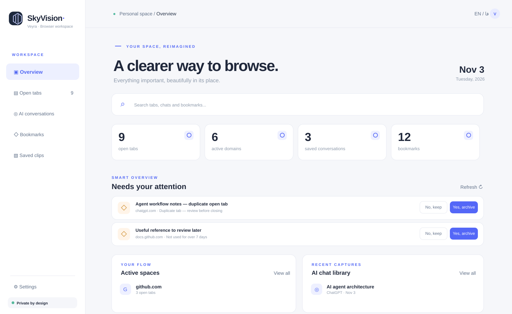

# Veyra — Your browser, in order.

> **Local-first · Chrome Manifest V3 · English / فارسی · Privacy-first**



*Illustrative preview of Veyra's dashboard. The UI layout is based on the current extension; displayed items and counts are sample data.*

**Veyra** is a lightweight browser workspace replacing the New Tab page with an organized dashboard for tabs, bookmarks, clipped content, and opt-in AI conversation archives. It aims to become a modular browser management hub, not just another tab organizer.

[راهنمای فارسی](README.fa.md) · [Architecture](docs/ARCHITECTURE.md) · [Roadmap](docs/ROADMAP.md) · [Agent handoff](AGENTS.md) · [Third-party notices](THIRD_PARTY_NOTICES.md)

## Capabilities (MVP)

| Feature | Current scope |
| --- | --- |
| New-tab dashboard | Replaces Chrome's new tab page; shows active tabs, domains, bookmarks, and archives |
| Smart review | Duplicate/idle tab suggestions with **Yes / No** decisions; no silent deletion |
| AI chat archive | Opt-in capture for ChatGPT, Claude, Gemini, Perplexity and Grok; DOM-based and best-effort |
| Portable knowledge | Local IndexedDB archive, JSON backup/import, Markdown conversation export |
| Bookmarks & clips | Search Chrome bookmarks and store selected text or links |
| Persian / English | RTL/LTR dashboard and site-specific RTL editing fields |
| Laya decision layer | Optional localhost decision suggestions; no external model service included |
| Privacy | On-device storage, explicit site permissions, no telemetry or account required |

**Status: early MVP.** The supplied source has automated unit and static tests. It has not yet been tested end-to-end as a Chrome Store build. Chat exporters may be incomplete on virtualized/updated third-party sites. Laya service is optional and not bundled. The periodic MV3 background review is not a continuously running process.

## Install in Chrome

1. Download the repository or a packaged extension release.
2. Navigate to `chrome://extensions` and enable **Developer mode**.
3. Click **Load unpacked** and choose the directory that contains `manifest.json`.
4. Open a new tab for Veyra. In settings, enable AI-site capture **per provider** only if desired.

Chrome does not allow extensions to silently change all browser startup preferences. To use the New Tab dashboard at startup, set Chrome → Settings → On startup → Open the New Tab page.

## Develop

Requires Node.js 20+ only to run tests. The extension itself has no npm runtime dependencies.

```bash
npm test
npm run check
npm run package
```

### Architecture

- `src/ui/`: Apple-inspired minimal dashboard and popup
- `src/background.js`: MV3 service worker, capture and periodic review
- `src/content/`: permission-gated AI chat extraction
- `src/db.js`: IndexedDB storage
- `src/core.js`: deterministic grouping, duplicate detection, Markdown export
- `src/laya.js`: optional Yes/No local decision adapter
- `tests/`, `docs/`, `AGENTS.md`: validation and future development

## Product principles

**Clear, user-controlled, reversible, extensible.** No automatic destructive action; explicit consent before browsing chat content; data is exportable; avoid unnecessary extension permissions; preserve bilingual accessibility and readable navigation.

**Credits & licensing:** MIT for this repository, with original third-party license notices for adapted modules inspired by [Tab Out](https://github.com/zarazhangrui/tab-out) and [LocalThink LTF Builder](https://github.com/localthink-org/localthink-builder). See `THIRD_PARTY_NOTICES.md` before redistribution.
